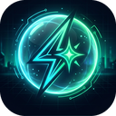

<div align="center">
  
  <h1>FloatBot AI (v1.0.0)</h1>
  <p><strong>Always-on-top Picture-in-Picture AI productivity assistant connected directly to your open ChatGPT browser tab.</strong></p>
</div>

---

## 🌟 Overview

**FloatBot AI** is a production-ready Chrome Extension (Manifest V3) that provides a persistent, resizable, interactive floating AI assistant window using Chromium's **Document Picture-in-Picture API**.

It operates at the OS level (`WS_EX_TOPMOST`), remaining permanently visible above **VS Code**, terminals, full-screen browsers, and desktop software without getting minimized or lost behind other windows. It communicates directly with your authenticated ChatGPT tab at [chatgpt.com](https://chatgpt.com), giving you the full power of your account (GPT-4o, reasoning, custom instructions) with **zero API fees** and **zero third-party servers**.

---

## 🚀 Key Features

1. **True Always-on-Top Floating Shell**:
   - Floats over VS Code, Discord, terminals, and all desktop apps via Chromium's native Document Picture-in-Picture engine.
2. **1-Click Screen Capture**:
   - Click **Screen** to instantly capture any active window or code snippet and send it straight to ChatGPT for code review and debugging.
3. **Document & File Analysis**:
   - Drag and drop or attach documents (**PDF**, **DOCX**, **CSV**, **JSON**, **code files**, **images**) for real-time analysis.
4. **Minimize to Floating Circle**:
   - Click **─** on the floating assistant to shrink it down to a tiny, non-intrusive neon circle widget on your screen. Click anytime to restore.
5. **Real-time Live Streaming**:
   - Chunks stream into the floating window character-by-character as ChatGPT generates them.
6. **Smart Companion Hub**:
   - Sized at a clean `620×680` dashboard that keeps the PiP process alive with live status indicators, safety notices, and quick-focus controls.
7. **Light & Dark Themes**:
   - Seamless one-click toggling between sleek obsidian dark mode and clean daylight mode.

---

## 📂 Project Structure

```
FloatBot AI/
├── manifest.json         # Manifest V3 configuration with production icon suite
├── icons/                # Production icon assets (16x16, 32x32, 48x48, 128x128, 512x512)
│   ├── icon-16.png
│   ├── icon-32.png
│   ├── icon-48.png
│   ├── icon-128.png
│   ├── icon-256.png
│   └── icon-512.png
├── background.js         # Service worker: manages tab discovery & window launch
├── chatgpt-bridge.js     # Content script: connects to chatgpt.com DOM & streaming
├── popup.html            # Extension action popup
├── popup.css             # Popup interface styling
├── popup.js              # Centered standalone window launcher
├── launcher.html         # Companion Hub & Document PiP assistant markup
├── launcher.css          # Design system & themes
├── launcher.js           # PiP lifecycle, screen media capture & stream handler
├── CHROMEWEBSTORE.md     # Chrome Developer Dashboard metadata & permissions guide
└── README.md             # Project documentation & release details
```

---

## 🛠️ Installation & Usage

1. Open Chrome and navigate to `chrome://extensions/`.
2. Enable **Developer mode** (toggle in the top-right corner).
3. Click **Load unpacked** and select the `FloatBot AI` project folder.
4. Open a tab with [https://chatgpt.com](https://chatgpt.com) and log into your account.
5. Click the **FloatBot AI** icon in your Chrome toolbar and select **Launch Floating Assistant**.
6. FloatBot AI will elevate into a floating window over your desktop. Happy coding!

---

## 🔒 Privacy & Permissions

FloatBot AI operates on a **100% local architecture**:
- **No data collection**: No telemetry, analytics, or user logging.
- **Direct browser communication**: Messages pass directly between your extension and your local ChatGPT tab.
- **No external servers**: Your prompts and files never touch any intermediary servers.

For full permission justifications and Chrome Web Store publishing metadata, see [CHROMEWEBSTORE.md](CHROMEWEBSTORE.md).
